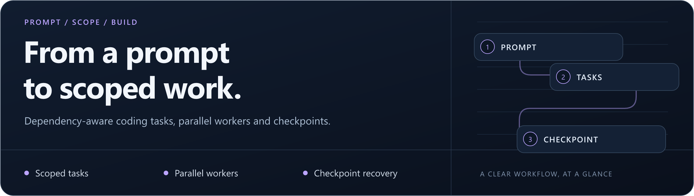

# ForgeFlow CLI

<p align="center">
  
</p>

**Turn a detailed project prompt into scoped, dependency-aware coding tasks.**

Node.js **20+** · Windows / macOS / Linux · Terminal-first · [MIT](LICENSE)

[Quick start](#quick-start) · [Workflow](#how-it-works) · [Controls](#controls-at-a-glance) · [Documentation](#documentation)

> **Project status:** Early preview. Syntax and installation diagnostics have been checked; live provider and browser workflows still need validation. Start with a small disposable project copy.

## Plan the work. Keep the scope clear.

ForgeFlow scans a project, requests a structured task plan and schedules workers when their dependencies are ready. Completed tasks are checkpointed so an interrupted run can resume.

| Scoped tasks | Parallel workers | Persistent runs |
| --- | --- | --- |
| Dependencies and writable file areas are validated before work starts. | Four workers by default, with role-specific tools. | Inspect saved state, logs and artifacts; resume completed checkpoints. |

The core CLI uses Node.js built-in modules. **Playwright is optional** and adds browser inspection through compact DOM snapshots; screenshots are saved locally rather than sent as model vision input.

## How it works

```text
Project prompt → Scan + plan → Validate scopes → Dependency queue → Workers
                                                                        |
                         Status + logs ← Saved checkpoints ←────────────┘
```

A task waits for prerequisites. Overlapping writable scopes are rejected. Failed work has a bounded retry allowance; generated changes still need review.

<details>
<summary>View the workflow illustration</summary>


</details>

## Quick start

```bash
git clone https://github.com/rvnsre/forgeflow-cli.git
cd forgeflow-cli
node ./bin/forgeflow.mjs doctor
```

No dependency install is required for the core CLI. Configure an API key you are authorized to use, then inspect a plan before starting workers:

<details open>
<summary><strong>Windows / PowerShell</strong></summary>

```powershell
$env:OPENAI_API_KEY = "your-api-key"
node .inorgeflow.mjs run --plan-only --dir C:Projectsmy-app "Inspect the project and plan searchable product filtering using its existing conventions and checks."
```

</details>

<details>
<summary><strong>Linux / macOS</strong></summary>

```bash
export OPENAI_API_KEY="your-api-key"
node ./bin/forgeflow.mjs run --plan-only --dir ~/Projects/my-app "Inspect the project and plan searchable product filtering using its existing conventions and checks."
```

</details>

Replace the key placeholder and project path. The example makes a planning API call. Run a new task without `--plan-only` to start workers. Include the outcome, allowed file areas, constraints and existing validation commands in the prompt.

If your endpoint uses a different model, set `FORGEFLOW_MODEL` to an ID it supports. [Provider settings and compatible-endpoint requirements →](docs/OPERATIONS.md#api-configuration)

`npm link` optionally exposes the shorter `forgeflow` command. The examples below use the direct entry point, so global linking is unnecessary.

## Controls at a glance

| Control | Default | Meaning |
| --- | --- | --- |
| Active workers | `--agents 4` | Supports 1–256 task slots; actual throughput depends on hardware, dependencies and provider limits. |
| Browser tools | Off | Enable with `--browser` after installing Playwright and Chromium. |
| Shell commands | Off | Enable explicitly with `--allow-shell`; commands run as your OS user. |
| Context estimate | `--context-tokens 8000` | Character-based estimate, not tokenizer-exact accounting. |
| Provider calls | `--max-calls 1000` | Includes retry requests. |
| Total token estimate | `--max-total-tokens 1000000` | A work bound, not a currency budget. |

### Inspect and resume

```bash
node ./bin/forgeflow.mjs status --dir ./my-app
node ./bin/forgeflow.mjs resume --run-id YOUR_RUN_ID --dir ./my-app
```

State is saved under `<project>/.forgeflow/runs/<run-id>/`. `Ctrl+C` requests a checkpointed stop. Incomplete tasks return to the queue when resumed; completed tasks stay complete.

### Optional browser setup

```bash
npm install playwright
npx playwright install chromium
```

Enable `--browser` for a run; add `--browser-headed` for visible Chromium. Each worker gets an isolated browser context. [Tools, destination rules and snapshot behavior →](docs/OPERATIONS.md#browser-tools)

## Operational boundaries

File scopes and command rules are application controls, not an OS sandbox. Treat project files, web content and terminal output as untrusted input. Your configured provider receives the prompts and included code excerpts. Review generated changes and redact logs before sharing them.

## Documentation

| Learn | Reference |
| --- | --- |
| [Agent coordination and worker profiles](docs/OPERATIONS.md#agent-coordination) | [All CLI options](docs/OPERATIONS.md#cli-reference) |
| [Context and token controls](docs/OPERATIONS.md#context-and-token-controls) | [Provider configuration](docs/OPERATIONS.md#api-configuration) |
| [Checkpoint files and recovery](docs/OPERATIONS.md#checkpoint-and-resume) | [Troubleshooting](docs/OPERATIONS.md#troubleshooting) |
| [Browser tools](docs/OPERATIONS.md#browser-tools) · [Shell access](docs/OPERATIONS.md#shell-execution) | [Validation](docs/OPERATIONS.md#validation) |
| [Contributing](CONTRIBUTING.md) | [Roadmap](ROADMAP.md) · [License](LICENSE) |

Check the CLI locally with `npm run check` and `node ./bin/forgeflow.mjs doctor`. These do not establish live provider or browser correctness. [Report an issue](https://github.com/rvnsre/forgeflow-cli/issues/new) with your OS, Node.js version, command and redacted error.

---

**More from rvnsre:** [Extreme Autopilot](https://github.com/rvnsre/extreme-autopilot) · [MedResearch](https://github.com/rvnsre/medresearch-cli) · [LocalDesk Agent](https://github.com/rvnsre/localdesk-agent)
