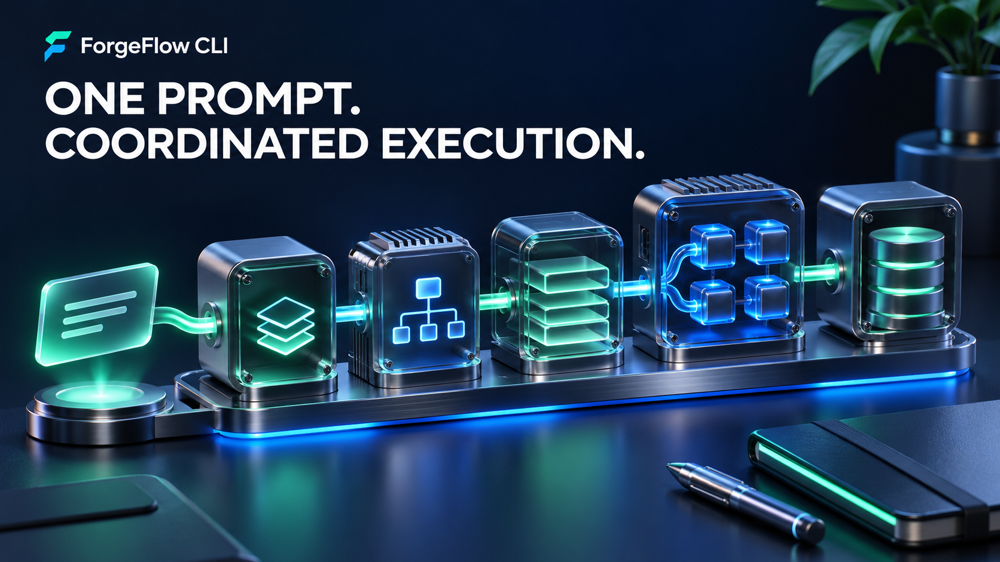
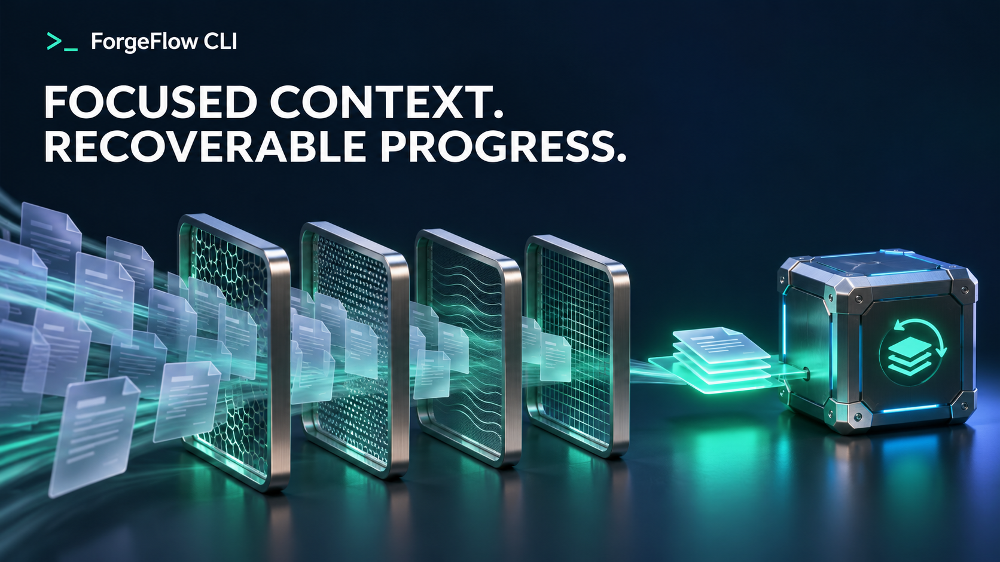

# ForgeFlow CLI

**Turn a detailed project prompt into a coordinated coding workflow.** ForgeFlow is a terminal application for Windows, macOS, and Linux that plans work, schedules scoped tasks, and saves progress for later recovery.

It supports **up to 256 concurrent task slots**, with a default of **4 workers**. Actual throughput depends on your API limits, model, machine, and task dependencies. The product illustrations below explain the workflow and are not application screenshots or benchmark results.

[Quick start](#quick-start) · [Browser tools](#browser-tools) · [Configuration](#api-configuration) · [Recovery](#checkpoint-and-resume) · [CLI reference](#cli-reference)

## What you can build with it

- Implement features across an existing codebase using a single detailed prompt.
- Split work into dependent tasks with separate file scopes.
- Inspect a local interface with optional Playwright browser tools.
- Resume interrupted runs without repeating completed tasks.
- Control context size, tool output, API calls, and estimated token usage.
- Inspect structured run state and logs from your terminal.

The core CLI uses Node.js built-in modules. Playwright is an optional dependency for browser automation.

## How the workflow operates



ForgeFlow scans the project, requests a structured plan, validates task scopes and dependencies, and schedules work when prerequisites are complete. Failed tasks have a bounded retry allowance. Each completed task is recorded in persistent run state.

The planner rejects overlapping writable scopes. Workers receive a role-specific tool set and can modify only their assigned file area through the file tools. This coordination reduces conflicting edits; it does not guarantee that every generated change is correct.

## Quick start

### 1. Get the source

```sh
git clone https://github.com/rvnsre/forgeflow-cli.git
cd forgeflow-cli
node ./bin/forgeflow.mjs doctor
```

You need **Node.js 20 or later** and an API key you are authorized to use. No dependency installation is required for the core CLI.

### 2. Configure your API key

PowerShell:

```powershell
$env:OPENAI_API_KEY = "your-api-key"
```

macOS or Linux:

```sh
export OPENAI_API_KEY="your-api-key"
```

The `.env.example` file documents environment settings. Set them in your terminal or process environment; copying the file alone does not configure the current shell.

### 3. Run a project task

PowerShell:

```powershell
node .\bin\forgeflow.mjs run --dir C:\Projects\my-app --agents 4 "Inspect the existing architecture, implement the requested feature in the project's style, run the relevant existing checks, fix issues, and update the documentation."
```

macOS or Linux:

```sh
node ./bin/forgeflow.mjs run --dir ~/Projects/my-app --agents 4 "Inspect the existing architecture, implement the requested feature in the project's style, run the relevant existing checks, fix issues, and update the documentation."
```

To expose the shorter `forgeflow` command, run `npm link` from this repository. If global linking is unavailable, keep using `node ./bin/forgeflow.mjs`.

### Write an effective project prompt

Include the desired outcome, project location, constraints, completion criteria, and checks to run. Identify any files or systems the agent must leave alone.

```text
Add searchable product filtering to this application.
Follow the current component and state conventions.
Support keyboard navigation and an empty-results state.
Use the project's existing validation commands.
Update the usage documentation and summarize changed files.
```

Use `--plan-only` to inspect the proposed task plan before execution. Shell commands require `--allow-shell`; browser tools require `--browser`.

## Agent coordination


| Capability | Behavior |
| --- | --- |
| Concurrency | 1–256 task slots; 4 active workers by default |
| Dependencies | A task waits for its prerequisites to finish |
| File ownership | Overlapping writable file scopes are rejected |
| Retry | Failed work is retried within the configured limit |
| Recovery | Completed tasks remain complete when a run resumes |
| Role selection | Task titles and descriptions determine the worker profile |

### Worker profiles

| Profile | Tools and purpose |
| --- | --- |
| `implementer` | General coding; read/write tools and optional shell/browser access |
| `documentation` | Documentation updates; read/write tools and optional browser access |
| `reviewer` | Read-only findings without modifying code |
| `test_engineer` | Read access and optional shell commands for existing checks |
| `browser_researcher` | Browser inspection with limited file reading |
| `architect` | Read-only architecture analysis |

Profiles are inferred from the task text. State the intended role clearly when a task could be classified in more than one way.

## Browser tools


Install Playwright and its Chromium runtime:

```sh
npm install playwright
npx playwright install chromium
```

Enable browser tools for a run:

```sh
forgeflow run --browser --dir ./my-app "Open the application, inspect the interface, and fix the reported UI issue."
```

Add `--browser-headed` to show Chromium. Each worker receives an isolated browser context.

| Tool | Purpose |
| --- | --- |
| `browser_open` | Open an HTTP or HTTPS page in the worker session |
| `browser_snapshot` | Return a compact semantic list of headings, links, buttons, and fields |
| `browser_click` | Click a reference from the latest snapshot |
| `browser_fill` | Enter text into a visible, non-password field |
| `browser_press` | Send a key to the page or a referenced element |
| `browser_screenshot` | Save a JPEG locally and return its path |
| `browser_close` | Release session browser resources |

Screenshots are not sent to the model as base64 image input. The model receives compact DOM snapshots and local screenshot paths. This reduces image payloads but does not provide the model with visual screenshot understanding.

The browser rejects password entry, credential-bearing URLs, `file:` URLs, private network destinations, and cloud metadata hosts. Localhost is permitted for local UI development.

## Context and token controls



ForgeFlow uses focused searches and line ranges, role-specific tools, bounded tool responses, and trimmed conversation history to reduce context growth. Tool calls and their responses are retained as complete groups when recent context is kept.

| Option | Default | What it limits |
| --- | ---: | --- |
| `--context-tokens` | 8000 | Estimated retained conversation context |
| `--tool-output-chars` | 4000 | Characters retained from one tool response |
| `--max-output-tokens` | 4000 | Output tokens requested per provider call |
| `--max-total-tokens` | 1000000 | Estimated input plus output tokens for the run |
| `--max-calls` | 1000 | HTTP API requests, including retries |
| `--agents` | 4 | Simultaneously executing tasks |

Token estimates are character-based, not tokenizer measurements. Provider usage is recorded when returned. These limits help bound work; they are not a currency budget or a promise of a particular bill. Start with 2–4 workers before increasing concurrency.

## Checkpoint and resume

Every run prints an ID and saves state under `<project>/.forgeflow/runs/<run-id>/`. Press `Ctrl+C` to stop active work while preserving completed task checkpoints.

```sh
forgeflow status --dir ./my-app
forgeflow resume --run-id <run-id> --dir ./my-app
```

Incomplete tasks return to the queue when resumed. Completed tasks are not rerun.

| File | Contents |
| --- | --- |
| `state.json` | Plan, task statuses, errors, and usage counters |
| `journal.jsonl` | Compact planning, task, and tool events |
| `events.jsonl` | Timestamped structured log events |
| `artifacts/` | Run artifacts and browser screenshots |

Recognized API-key formats are redacted from recorded prompt and journal values. Review logs before sharing them.

## API configuration

| Environment variable | Purpose |
| --- | --- |
| `OPENAI_API_KEY` | Primary API key |
| `FORGEFLOW_API_KEYS` | Optional additional keys you own, separated by commas, semicolons, or whitespace |
| `FORGEFLOW_MODEL` | Model identifier; default `gpt-6.1-sol` |
| `FORGEFLOW_TOKEN_LIMIT_PARAMETER` | Output token field; default `max_completion_tokens`; use `max_tokens` for compatible legacy endpoints |
| `FORGEFLOW_BASE_URL` | API root; default `https://api.openai.com/v1` |
| `OPENAI_ORGANIZATION` | Optional organization header |
| `OPENAI_PROJECT` | Optional project header |

The provider uses the Chat Completions request format. An alternative endpoint must support `POST /chat/completions`, tool calling, and JSON response formatting. Choose a model identifier supported by your endpoint and account.

```sh
export FORGEFLOW_BASE_URL="https://api.example.com/v1"
export FORGEFLOW_MODEL="your-model-id"
forgeflow run --dir ./my-app "Implement the requested feature."
```

Keys are read from your configured environment. ForgeFlow does not discover, collect, or generate keys. It switches to another configured key only after a `401` or `403` authentication failure. A `429` response waits according to `Retry-After` using the same key; key rotation is not used to evade rate limits.

## Shell execution

Shell tools are disabled by default. Enable them explicitly when your task needs project commands:

```sh
forgeflow run --allow-shell --dir ./my-app "Implement the feature and run the existing project checks."
```

Commands run in the project directory with your operating-system permissions. Recognized credential environment variables are removed from child processes. Known destructive command patterns and some credential-reading patterns are blocked. This is a command policy, not an operating-system sandbox.

## CLI reference

```text
forgeflow run [options] [prompt]
forgeflow resume --run-id <id> [options]
forgeflow status [--dir <project>]
forgeflow doctor
```

| Option | Default |
| --- | --- |
| `--dir <path>` | Current directory |
| `--agents <1..256>` | 4 |
| `--max-tasks <1..256>` | 256 |
| `--max-steps <n>` | 80 per task |
| `--max-calls <n>` | 1000 |
| `--context-tokens <n>` | 8000 |
| `--tool-output-chars <n>` | 4000 |
| `--max-output-tokens <n>` | 4000 |
| `--max-total-tokens <n>` | 1000000 |
| `--token-parameter <name>` | `max_completion_tokens` |
| `--task-retries <0..10>` | 1 |
| `--requests-per-minute <n>` | 60 |
| `--timeout-ms <n>` | 90000 per provider request |
| `--task-timeout-ms <n>` | 1800000 |
| `--plan-timeout-ms <n>` | 120000 |
| `--command-timeout-ms <n>` | 120000 |
| `--model <name>` | `gpt-6.1-sol` |
| `--base-url <url>` | OpenAI API root |
| `--allow-shell` | Disabled |
| `--browser` | Disabled |
| `--browser-headed` | Disabled |
| `--plan-only` | Disabled |
| `--quiet` | Disabled |

Pass `-` as the prompt to read a long specification from standard input:

```sh
cat task.txt | forgeflow run --dir ./my-app -
```

PowerShell equivalent:

```powershell
Get-Content -Raw task.txt | forgeflow run --dir .\my-app -
```

## Project structure

```text
bin/forgeflow.mjs       Terminal entry point
src/cli.mjs             Commands and argument parsing
src/orchestrator.mjs    Planning, scheduling, workers, and checkpoints
src/planner.mjs         Plan validation, scopes, and dependencies
src/task-queue.mjs      Dependency scheduling, concurrency, and retries
src/provider.mjs        Provider requests, backoff, and usage limits
src/browser.mjs         Playwright contexts and semantic snapshots
src/workspace.mjs       Scoped paths, atomic writes, search, and diffs
src/tools.mjs           Tool definitions and dispatch
src/policy.mjs          Tool permissions and command rules
src/command-runner.mjs  Shell execution, timeouts, and environment filtering
src/usage-budget.mjs    Estimated total token accounting
src/text-budget.mjs     Context trimming and secret redaction
src/run-store.mjs       Persistent state and journals
src/workflow.mjs        Run phases and task events
src/agent-profiles.mjs  Role-specific tool and context limits
src/diagnostics.mjs     Installation diagnostics
```

## Operational boundaries

- File tools enforce the project root and worker file scope; symlink escapes are rejected.
- Shell access uses your account permissions and is not a container.
- Browser contexts isolate worker cookies, while browser destination checks restrict network access.
- Project files, web pages, and terminal output are untrusted inputs and may contain prompt injection.
- Your configured API endpoint receives prompts and the code excerpts included in requests.
- Generated work still needs review. A finished task status does not prove production readiness.

## Troubleshooting

| Symptom | Action |
| --- | --- |
| API key missing | Set `OPENAI_API_KEY` in the terminal that starts ForgeFlow |
| Model unavailable | Select a model your configured endpoint supports |
| `429` or long `Retry-After` | Reduce concurrency and request rate; stop and resume later if necessary |
| Playwright missing | Run `npm install playwright` and `npx playwright install chromium` |
| Run interrupted | Inspect `status`, then resume using the printed run ID |
| Scope conflict | Group related files into one task or start a new run with a clearer prompt |
| Task failed | Inspect `state.json` and `events.jsonl` for the recorded error |

## Validation

```sh
npm run check
node ./bin/forgeflow.mjs doctor
```

The syntax check validates `.mjs` files with Node.js. It does not run integration tests or make provider API calls. Live API and browser execution have not been verified for this release.

## License

MIT. See [LICENSE](LICENSE).
