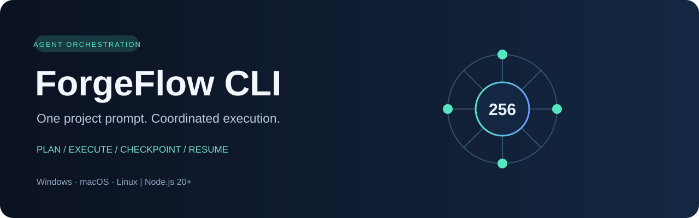

# ForgeFlow CLI



ForgeFlow bir uzun layihə promptunu planlaşdıran, işi fayl sahələrinə görə bölən və terminaldan idarə olunan kodlaşdırma agentlərini növbə ilə işlədən proqramdır. Windows, macOS və Linux-da Node.js 20+ ilə işləyir.

## Nə edir

- Layihə fayllarını skan edib tapşırıq planı yaradır.
- Tapşırıqları 1–256 paralel agentə qədər işlədə bilir; standart paralellik 4-dür.
- Hər agentə icazə verilən fayl sahəsi verir. Eyni faylın iki agentə verilməsi və üst-üstə düşən qovluq sahələri rədd edilir.
- Asılı tapşırıqları əvvəlki tapşırıqlar tamamlanana qədər gözlədir.
- Uğursuz işi məhdud sayda yenidən sınayır. Tamamlanmış tapşırıqları checkpoint kimi saxlayır və sonradan davam etdirir.
- OpenAI Chat Completions formatı ilə işləyir; uyğun API endpoint-i də konfiqurasiya etmək olar.
- İstəyə görə Playwright vasitəsilə Chromium brauzerini aça, səhifədən yığcam məzmun oxuya, klikləyə, mətn sahəsinə məlumat yaza və lokal screenshot saxlaya bilər.
- Kontekst, alət cavabı, ümumi token və API çağırışı üçün limitlərə malikdir.
- Run vəziyyətini, xətaları, alət nəticələrinin qısa qeydini və provider usage göstəricilərini `.forgeflow/runs/` altında saxlayır.

## Tələblər

- Node.js 20 və ya daha yeni versiya
- İstifadə etməyə icazəniz olan API açarı
- Brauzer funksiyası lazım olsa Playwright və Chromium

Üçüncü tərəf Node paketləri əsas CLI üçün tələb olunmur. Playwright istəyə bağlıdır.

## Tez başlama

### PowerShell

```powershell
$env:OPENAI_API_KEY = "öz-api-açarınız"
node .\bin\forgeflow.mjs run --dir C:\Projects\my-app --agents 4 "Mövcud strukturu araşdır, sifariş edilən funksiyanı layihə üslubuna uyğun tamamla, uyğun yoxlamaları apar və sənədləri yenilə."
```

### macOS / Linux

```sh
export OPENAI_API_KEY="öz-api-açarınız"
node ./bin/forgeflow.mjs run --dir ~/Projects/my-app --agents 4 "Mövcud strukturu araşdır, sifariş edilən funksiyanı layihə üslubuna uyğun tamamla, uyğun yoxlamaları apar və sənədləri yenilə."
```

### Global terminal komandası

Bu qovluqda:

```sh
npm link
```

Sonra terminalda `forgeflow run ...` işlədə bilərsiniz. NPM qlobal link yaratmağa icazə verməsə, `node ./bin/forgeflow.mjs ...` forması hər platformada işləyir.

## Brauzer dəstəyi

Playwright quraşdırın:

```sh
npm install playwright
npx playwright install chromium
```

Brauzer alətlərini aktiv edin:

```sh
forgeflow run --browser --dir ./my-app "Səhifəni aç, UI-dəki səhvi tap, kodu düzəlt və yoxla."
```

Chromium-u görünən pəncərədə açmaq üçün `--browser-headed` əlavə edin:

```sh
forgeflow run --browser --browser-headed --dir ./my-app "Səhifəni yoxla və tapdığın problemi düzəlt."
```

Brauzer funksiya siyahısı:

- `browser_open`: HTTP və HTTPS səhifəsini ayrıca sessiyada açır.
- `browser_snapshot`: başlıqları, görünən linkləri, düymələri və form sahələrini qısa semantik siyahı kimi qaytarır.
- `browser_click`: son snapshot-dan alınmış `ref` elementinə klik edir.
- `browser_fill`: parol olmayan görünən sahəyə mətn yazır.
- `browser_press`: səhifədə və ya göstərilən elementdə klaviatura düyməsi basır.
- `browser_screenshot`: JPEG screenshot-u lokal fayla yazır və yalnız yolu qaytarır.
- `browser_close`: sessiyanın brauzer resurslarını bağlayır.

Browser screenshot-u API-yə base64 kimi göndərilmir. Agent əvvəlcə az token işlədən DOM snapshot-a baxır; yalnız vizual detal gərəkəndə screenshot alır. Brauzer alətləri parol daxil etmir, private IP və metadata hostlarına gedən sorğuları bloklayır. `localhost` yerli UI sınağı üçün açıqdır.

## Terminal komandaları

Shell aləti standartda bağlıdır. Açmaq üçün:

```sh
forgeflow run --allow-shell --dir ./my-app "Funksiyanı yaz, mövcud layihə yoxlamalarını işə sal, xətaları düzəlt."
```

Komandalar layihə qovluğunda və cari OS istifadəçisinin icazələri ilə işləyir. Uşaq prosesə API açarı və digər tanınan credential environment dəyişənləri ötürülmür. Məlum dağıdıcı əmrlər və açarları oxumağa yönələn bəzi əmrlər bloklanır; bu məhdudiyyət OS sandbox-ı deyil. Yalnız etibar etdiyiniz layihələrdə `--allow-shell` işlədin.

## Run-i davam etdirmək

Hər run öz ID-sini göstərir və checkpoint-ləri `<layihə>/.forgeflow/runs/<run-id>/state.json` altında saxlayır. `Ctrl+C` işləyən sorğunu dayandırır və tamamlanmış tapşırıqları saxlayır.

```sh
forgeflow status --dir ./my-app
forgeflow resume --run-id 20261109142500-a1b2c3d4 --dir ./my-app
```

Run status faylları:

- `state.json`: plan, task statusları, xətalar və usage göstəriciləri.
- `journal.jsonl`: planlama, task statusları və alət hadisələrinin qısa jurnalı.
- `events.jsonl`: tarixli structured log hadisələri.
- `artifacts/`: run zamanı yaranan fayllar və screenshot-lar üçün yer.

Yarımçıq task-lar `resume` zamanı yenidən növbəyə düşür. Tamamlanmış tapşırıqlar təkrar işə salınmır. Prompt və jurnal dəyərlərində açıq API key formatları maskalanır.

## API konfiqurasiyası

Ən azı bir öz API açarınızı environment dəyişəninə verin:

| Dəyişən | Nə üçündür |
| --- | --- |
| `OPENAI_API_KEY` | Əsas API açarı |
| `FORGEFLOW_API_KEYS` | İstəyə bağlı əlavə, sizə məxsus açarlar; vergül, nöqtəli vergül və ya boşluqla ayırın |
| `FORGEFLOW_MODEL` | Model adı; ilkin dəyər `gpt-6.1-sol` |
| `FORGEFLOW_TOKEN_LIMIT_PARAMETER` | Çıxış token həddi field-i; ilkin dəyər `max_completion_tokens`, legacy endpoint-lərdə `max_tokens` |
| `FORGEFLOW_BASE_URL` | OpenAI-compatible API root; ilkin dəyər `https://api.openai.com/v1` |
| `OPENAI_ORGANIZATION` | Opsional təşkilat header-i |
| `OPENAI_PROJECT` | Opsional layihə header-i |

Açarlar sırf sizin environment konfiqurasiyanızdan oxunur. ForgeFlow açar axtarmır, toplamaz və yaratmır. Cari açar yalnız 401/403 authentication xətasında növbəti konfiqurasiya olunmuş açarla əvəz edilir. 429 cavabında eyni açarla `Retry-After` gözlənir; açar hovuzu rate limit-i keçmək üçün istifadə edilmir.

OpenAI-compatible endpoint üçün:

```sh
export FORGEFLOW_BASE_URL="https://api.example.com/v1"
export FORGEFLOW_MODEL="model-name"
forgeflow run "..."
```

Endpoint `POST /chat/completions`, tool calling və JSON response formatını dəstəkləməlidir.

## Token və xərcləmə nəzarəti

| Seçim | İlkin dəyər | Təsiri |
| --- | ---: | --- |
| `--context-tokens` | 8000 | Modelə saxlanılan son dialoq kontekstinin təxmini yuxarı həddi |
| `--tool-output-chars` | 4000 | Bir alət cavabından dialoqda saxlanılan maksimum simvol sayı |
| `--max-output-tokens` | 4000 | Bir provider çağırışı üçün cavab token həddi |
| `--max-total-tokens` | 1000000 | Run üzrə təxmini giriş+cavab token limiti |
| `--max-calls` | 1000 | Run üzrə HTTP API sorğularının yuxarı həddi; retry də sayılır |
| `--agents` | 4 | Eyni vaxtda işləyən task sayı |

Token qənaəti üçün ForgeFlow:

1. Faylları tam oxumaq əvəzinə uyğun sətirləri axtarır və sətir diapazonu oxuyur.
2. Hər task-a roluna uyğun daha kiçik tool siyahısı verir.
3. Köhnə dialoq dövrlərini saxlamır; son tool call və nəticələri bütöv qrup kimi qoruyur.
4. DOM snapshot-u qısa saxlayır, screenshot-u model mətninə daxil etmir.
5. Hər run üçün ümumi təxmini token büdcəsi saxlayır.
6. Provider `usage` qaytarırsa faktiki token sayını, qaytarmırsa ehtiyatlı təxmini hesabı qeyd edir.

Hesablanmış token sayı tokenizer-dən alınmır, simvol uzunluğuna əsaslanan təxmindir. Provider, model və alət seçimi faktiki ödənişi dəyişir. `--agents 256` çoxlu paralel sorğu və yüksək xərc yarada bilər; əvvəlcə 2–4 agentlə başlayın.

## Komanda seçimləri

```text
forgeflow run [options] [prompt]
forgeflow resume --run-id <id> [options]
forgeflow status [--dir <project>]
forgeflow doctor
```

| Seçim | İlkin dəyər |
| --- | ---: |
| `--dir <path>` | Cari qovluq |
| `--agents <1..256>` | 4 |
| `--max-tasks <1..256>` | 256 |
| `--max-steps <n>` | 80 hər task üçün |
| `--max-calls <n>` | 1000 |
| `--context-tokens <n>` | 8000 |
| `--tool-output-chars <n>` | 4000 |
| `--max-total-tokens <n>` | 1000000 |
| `--token-parameter <name>` | `max_completion_tokens` |
| `--task-retries <0..10>` | 1 |
| `--requests-per-minute <n>` | 60 |
| `--timeout-ms <n>` | 90000 provider sorğusu üçün |
| `--task-timeout-ms <n>` | 1800000 |
| `--plan-timeout-ms <n>` | 120000 |
| `--command-timeout-ms <n>` | 120000 |
| `--model <name>` | `gpt-6.1-sol` |
| `--base-url <url>` | OpenAI endpoint |
| `--allow-shell` | bağlı |
| `--browser` | bağlı |
| `--browser-headed` | bağlı |
| `--plan-only` | bağlı |
| `--quiet` | bağlı |

Prompt-u `-` kimi verib stdin-dən oxuya bilərsiniz:

```sh
cat task.txt | forgeflow run --dir ./my-app -
```

## Agent profilləri

| Profil | Alət məhdudiyyəti | Nə iş görür |
| --- | --- | --- |
| `implementer` | Oxu, yazı, shell/browser opsional | Ümumi kodlaşdırma tapşırıqları |
| `documentation` | Oxu, sənəd yazısı, browser opsional | README və texniki sənədlər |
| `reviewer` | Yalnız oxu | Tapıntıları fayl üzrə yazır, kodu dəyişmir |
| `test_engineer` | Oxu və shell opsional | Mövcud yoxlama əmrlərini icra edir |
| `browser_researcher` | Brauzer, məhdud oxu | İctimai web/UI məlumatı toplayır |
| `architect` | Yalnız oxu | Koda dəyişiklik etmədən arxitekturanı araşdırır |

Profil tapşırığın başlığı və mətnindən avtomatik seçilir. Səhv tapşırıq təsnifatı baş verərsə, istənilən task kontekstində rolu açıq göstərən prompt yazın.

## Təhlükəsizlik sərhədləri

- Açarlar prompt-a, jurnal faylına və child shell environment-ə ötürülməməlidir.
- Modelin fayl alətləri project root-dan kənara yaza bilmir; simvolik link ilə root-dan kənara çıxış bloklanır.
- Hər agent yalnız ona verilmiş fayl sahəsinə yaza bilər.
- `--allow-shell` açıq olduqda shell command cari istifadəçi hüquqları ilə işləyir. Bu, container və ya OS sandbox deyil.
- `--browser` ilə hər worker üçün ayrıca Chromium context yaradılır və həmin sessiyanın cookie-ləri digər task-lardan təcrid olunur.
- Browser `file:`, credential daxil edilmiş URL, private IP və cloud metadata hostlarına çıxışı rədd edir. `localhost` UI geliştirməsi üçün icazəlidir.
- Browser səhifəsi, layihə faylı və terminal çıxışı prompt injection mənbəyi sayıla bilər; onların mətnindəki göstərişləri yerinə yetirməyin.
- API endpoint prompt-u və modelə göndərilən layihə hissələrini qəbul edir. Yalnız paylaşmağa icazəniz olan kodu göndərin.
- Komanda xətaları və model cavabları limitli uzunluqda saxlanılır; ayrıca `events.jsonl` structured jurnalı var.

## Layihə quruluşu

```text
bin/forgeflow.mjs       CLI giriş nöqtəsi
src/cli.mjs             Parametrlər və komandalar
src/orchestrator.mjs    Plan → növbə → worker → checkpoint dövrü
src/planner.mjs         Plan JSON, scope və asılılıq yoxlamaları
src/task-queue.mjs      Dependency-aware concurrency və retry
src/provider.mjs        API çağırışı, backoff, token/call büdcəsi
src/browser.mjs         Playwright sessiyaları və kompakt DOM snapshot
src/workspace.mjs       Path scope, atomik yazı, inventar, axtarış, diff
src/tools.mjs           Model alətləri və dispatcher
src/policy.mjs          Tool icazələri və shell qaydaları
src/command-runner.mjs  Timeout və təmizlənmiş environment ilə shell
src/usage-budget.mjs    Təxmini ümumi token sayğacı
src/text-budget.mjs     Kontekst yığcamlaşdırma və secret redaksiyası
src/run-store.mjs       Dayanıqlı run vəziyyəti və jurnal
src/workflow.mjs        Run phase və task hadisələrinin izlənməsi
src/agent-profiles.mjs  Rol üzrə alət və kontekst limitləri
src/diagnostics.mjs     `doctor` yoxlamaları
```

## Troubleshooting

### `OPENAI_API_KEY` missing

API key-i cari terminal sessiyasında təyin edin. PowerShell-dən təyin edilən dəyişən həmin pəncərə bağlanana qədər qüvvədə qalır.

### `429` və ya böyük `Retry-After`

ForgeFlow provider limitinə hörmət edərək gözləyir. `Retry-After` 2 dəqiqədən uzundursa prosesi dayandırıb daha sonra `resume` edin. Paralelliyi və requests/minute limitini azalda bilərsiniz.

### Browser `Playwright` error

Əvvəlcə `npm install playwright`, sonra `npx playwright install chromium` işlədin. `node ./bin/forgeflow.mjs doctor` quraşdırmanı yoxlayır.

### Run dayandı və ya task uğursuz oldu

`forgeflow status --dir <project>` işlədib run ID-ni `forgeflow resume --run-id <id> --dir <project>` əmrinə verin. `state.json` və `events.jsonl` diaqnostika məlumatı saxlayır.

### Alət fayl sahəsi xətası

Tapşırığın fayl sahəsini nəzərdən keçirin və prompt-u daha kiçik tapşırıqlara bölün. Bir neçə fayl eyni işə aiddirsə, həmin faylları bir task-a verin; planı yenidən yaratmaq üçün yeni run başladın.

## Syntax check

```sh
npm run check
```

Bu əmr bütün `.mjs` faylları üçün Node.js sintaksis yoxlaması aparır. İnteqrasiya testi və API çağırışı etmir.

## Lisenziya

MIT. [LICENSE](LICENSE) faylına baxın.
